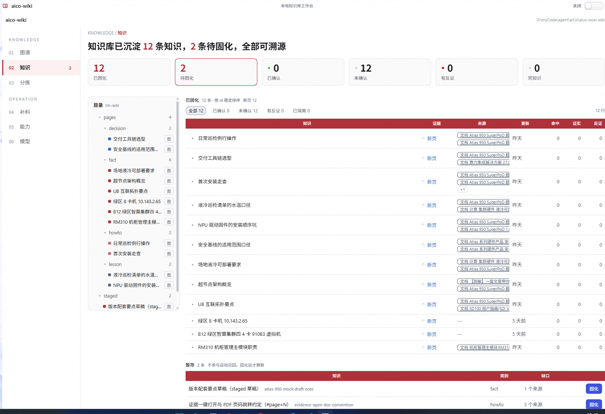

# aico-llm-wiki

> aiCo 的「边做边学」本地知识库插件。fork 自 [Dayi-Z/dsh-learn-wiki](https://github.com/Dayi-Z/dsh-learn-wiki)，v0.4.0 起收编为 aiCo 自有插件。



## 它做什么

把 CRAG 的纠错回路搬到 agent 循环上：

**工作前自动检索 → 卡住时后台限流联网补料 → 蒸馏落暂存 → 人工 commit 升入知识库 → 下次自动命中。**

触发器是**挣扎**（反复失败/撞墙），不是廉价的"检索未命中"——学到的东西沉淀为可溯源的 Markdown 知识页，同一个坑不踩第二次。

## 安装

```powershell
dsh plugin add github:yangjingo/aico-llm-wiki
# 本地开发
dsh plugin add link:D:/myCode/agent/aiCo/aico-llm-wiki
```

零构建、纯 JS；宿主依赖只声明为 `peerDependencies`，不要装第二份。

## 核心工具

| 工具 | 作用 |
|---|---|
| `wiki_recall` | 检索知识库（hit / weak / miss 三分桶） |
| `wiki_learn` / `wiki_harvest` | 沉淀知识：单条 / 从对话提炼 |
| `wiki_sessions` | 读历史会话（接手简报 / 跨会话撞墙分析） |
| `wiki_review` / `wiki_commit` | 审阅暂存区 / 固化入知识库 |
| `wiki_lint` / `wiki_merge` | 体检 / 合并知识页 |

## 前端结构（组件化）

前端（浏览器半）源码**只**放在 `client/src/`，按组件分文件，与后端（`index.js` + `lib/`）零共享代码——两者只通过 `/api/*` 只读端点对话：

| 文件 | 组件 |
|---|---|
| `00-boot.js` | ModuleLoader 装载 + React / DSH 原语 + API 端点 |
| `01-primitives.js` | UI 原语包装（Btn / Chip / Dot / Field / Md…） |
| `02-styles.js` | 全部 `.lw-*` 样式 |
| `03-utils.js` / `04-view-logic.js` | 小工具 / 视图纯函数 |
| `05-capabilities.js` | 能力页签（工具 + 技能） |
| `06-knowledge.js` | 知识页签（活行表格 + 暂存区） |
| `07-acquire.js` | 补料页签 |
| `08-models.js` | 模型页签 |
| `09-graph.js` | vendor 加载 + 知识图谱 |
| `10-shell.js` | 外壳 + 二级界面 |
| `11-todos.js` | 待办（角标 / 提示条 / 提示卡） |
| `12-contract.js` | 插件契约导出 |

「逻辑分区」以各 src 文件内的「`// ── 模块：… ──`」注释标界（env/api/format/ui/style/components/<页签>/contract，共 17 个分区头）；分区与文件边界不必一一对应——跨文件的分区，主体所在文件放分区头，其余文件顶部加一行指路注释。

宿主的客户端装载契约（`window.__ModuleLoader__.load`）只接受**单文件**产物，所以改完 `client/src/*` 后运行：

```powershell
pnpm run build:client   # 按文件名顺序拼接成 client/client.js（运行时零构建不变）
```

## 自检

```powershell
npm run verify:core    # 解析 / 索引 / 打分
npm run verify:loop    # 端到端闭环（防投毒）
npm run verify:render  # UI 结构级渲染测试
```

24 个套件全部离线可跑。

## 文档

详细设计、配置项、标定方法与踩坑记录见：

- [docs/design.md](docs/design.md) — 架构与决策表
- [docs/upstream-readme.md](docs/upstream-readme.md) — 完整版 README（三层架构、设计铁律、阈值标定、挣扎检测设计）
- [docs/spec/](docs/spec/) — 历次方案 spec
- [docs/evidence/](docs/evidence/) — 截图与证据
- [docs/integration-report.md](docs/integration-report.md) — 安装与集成记录
